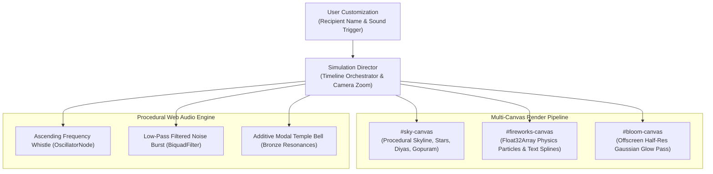

# Diwali Sky — Real-Time Fireworks Simulator & Particle Engine

> **Live Application:** [diwalisky.vercel.app](https://diwalisky.vercel.app/)  
> **Autonomous Interactive Reel:** [diwalisky.vercel.app/?demo=1&name=Priya](https://diwalisky.vercel.app/?demo=1&name=Priya)  
> **In-Browser Test Suite:** [diwalisky.vercel.app/?test=1](https://diwalisky.vercel.app/?test=1)  
> **Author:** [B Pradeep](https://github.com/Pradeep-B28) · [Portfolio](https://pradeep-b28.github.io/Pradeep-B28/)

---

## Overview

**Diwali Sky** is a hardware-accelerated 2D canvas particle simulator and procedural audio engine that renders cinematic fireworks and spells personalized typography in explosive spark physics across a nighttime temple skyline.

Engineered with zero external dependencies, zero sound files, and zero runtime frameworks. Features high-performance TypedArray particle pooling with zero garbage collection allocations in the 60 FPS animation loop.



---

## Engineering Highlights

| Feature | Technical Architecture |
| :--- | :--- |
| **Zero GC Particle Pooling** | All particle attributes (x, y, vx, vy, life, decay, size, color) reside in pre-allocated `Float32Array` buffers. Zero objects are allocated during 60 FPS rendering, eliminating garbage collection frame drops. |
| **Stacked Canvas Pipeline** | Three hardware-accelerated canvas layers: static background `#sky-canvas`, dynamic particle `#fireworks-canvas`, and a half-resolution `#bloom-canvas` utilizing blend modes for atmospheric illumination. |
| **Procedural Audio Synthesis** | All audio (rocket launch sweeps, concussive explosions, bronze temple bells, spark crackles) is generated via the native browser Web Audio API—zero MP3 or WAV network downloads. |
| **Dynamic Quality Throttle** | Continuously samples render times over 2-second windows. If frame rates drop below 45 FPS on low-power devices, particle counts and bloom passes automatically step down to preserve smooth interaction. |
| **Zero-Server URL Privacy** | Recipient names and customization parameters are serialized entirely in client-side base64url URL hashes (`#s=...`), guaranteeing privacy with no telemetry backend. |

---

## Dynamic Performance Scaling

| Metric | High Tier (Desktop Default) | Medium Tier (Mobile Default) | Low Tier (Power Saver) |
| :--- | :--- | :--- | :--- |
| **Active Particle Cap** | 6,000 particles | 2,500 particles | 1,500 particles |
| **Atmospheric Bloom Pass** | Enabled (half-resolution) | Disabled | Disabled |
| **Background Detail** | Gopuram, city skyline, diyas, lanterns | Full skyline | Simplified static silhouette |
| **Dynamic Camera Push** | 1.14x smooth focal zoom | 1.14x smooth focal zoom | Static camera |
| **Target Frame Rate** | 60 FPS | $\ge$ 45 FPS | $\ge$ 45 FPS |

---

## Automated In-Browser Verification

The project includes an integrated test suite validating particle buffer integrity, audio graph connections, text rasterization, and URL hash serialization:

```
https://diwalisky.vercel.app/?test=1
```

---

## Local Development Setup

No build step, compilation, or package manager installation is required.

1. **Clone the repository:**
   ```bash
   git clone https://github.com/Pradeep-B28/Diwali_Sky.git
   cd Diwali_Sky
   ```

2. **Run a static HTTP server:**
   ```bash
   # Using Python 3
   python -m http.server 8000
   ```

3. **Open in browser:**
   ```
   http://localhost:8000/
   ```

---

## License

This project is licensed under the [MIT License](LICENSE).
